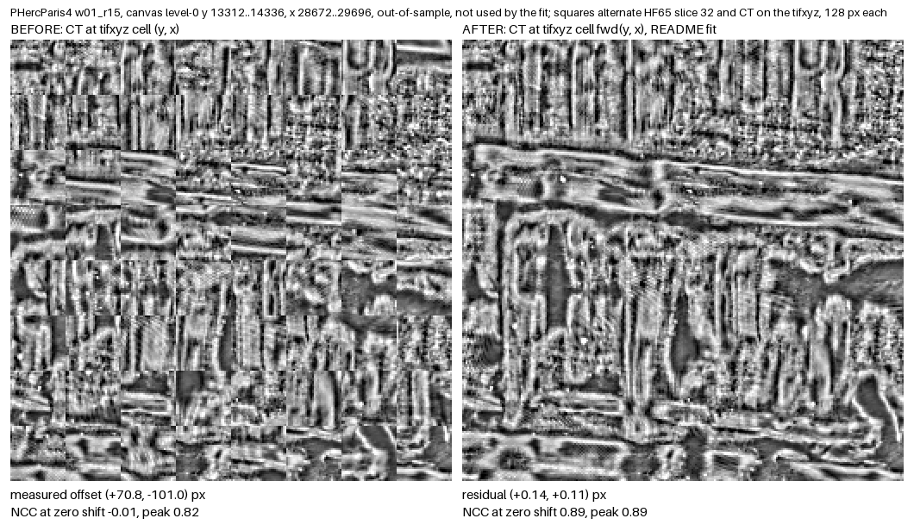

# HF65 canvas vs tifxyz offset (2026-10-30)

Measurements behind [ScrollPrize/villa#2370](https://github.com/ScrollPrize/villa/issues/2370), which answers question 1 of [#2346](https://github.com/ScrollPrize/villa/issues/2346): on the segments below, pixel (y, x) of the 65-slice HF surface volume ("HF65 canvas") in `scrollprize/datasets` `ink/<scroll>/<segment>/` does not show the CT at tifxyz full-res cell (y, x) of the tifxyz in the same folder.

[`audit/`](audit/) runs the same measurement on all 32 training segment folders in `ink/`: 26 offset, 5 aligned, 1 not measured.

## Correction

Sampling the CT at tifxyz cell (y + dy, x + dx), with dy and dx from the fits under "Result", lines HF65 slice 32 up with the CT to within 0.4 px on both axes, in all 32 regions tested: the 24 the fits were made from and 8 they never saw (two new regions per Paris4 segment, one on w018, and the held-out w01 region). Before the correction the same regions were off by up to 254 px on one axis. After it the NCC peak is at zero shift in every region.

`correct/apply_fit.py` maps canvas pixels to tifxyz cells and back and resamples a canvas or label tile into the tifxyz frame, which is the grid `full_3d` training reads. `correct/RESULTS.md` has the full before/after table, a second check of the inverse map, and what is not shown. It also covers the MAN5_outer_3 label frame from [villa#2369](https://github.com/ScrollPrize/villa/issues/2369) (`man5/`).



## Result

Offset convention: canvas content at (y, x) lies at tifxyz cell (y + dy, x + dx), in level-0 px. Six 1024 px regions per segment, inside the supervision mask.

| segment | dy range | dx range | peak NCC | best other peak |
|---|---|---|---|---|
| phercparis4 w00_20231016151002 | -16.6 to -3.0 | -13.5 to +9.9 | 0.82 to 0.88 | 0.12 or less |
| phercparis4 w01_20230702185753_r15 | +53.2 to +253.9 | -155.0 to -51.5 | 0.79 to 0.87 | 0.15 or less |
| phercparis4 w05_4424 | -33.8 to -4.4 | -9.8 to +16.5 | 0.82 to 0.92 | 0.17 or less |
| 1667 w018_20240304144031_2um | -19.7 to -19.6 | -19.7 to -19.6 | 0.91 to 0.93 | 0.10 or less |

Per-axis fits d = a + b*y + c*x, in level-0 canvas px (`correct/apply_fit.py` model "affine3"):

| segment | dy | dx |
|---|---|---|
| w00 | -20.6991 + 0.0009926*y + 0.0000013*x | +11.0864 + 0.0000224*y - 0.0006630*x |
| w01_r15 | +11.5100 + 0.0042631*y + 0.0000060*x | +11.8180 + 0.0000025*y - 0.0038761*x |
| w05_4424 | -42.3946 + 0.0007890*y + 0.0000008*x | +22.9348 - 0.0000042*y - 0.0004539*x |
| w018 | -19.64 (constant, sd 0.03) | -19.64 (constant, sd 0.03) |

Fit residuals are 0.35 px or less. The first version of this README printed only the larger slope per axis; that shorter form leaves up to 0.47 px (w00 dx) and is the model `correct/` was tested with. The Paris4 slopes equal (tifxyz full-res size / canvas size - 1) on each axis, which comes from the metadata alone:

| segment | rows: tifxyz / canvas | cols: tifxyz / canvas |
|---|---|---|
| w00 | 32281 / 32249 (0.000992) | 51345 / 51380 (-0.000681) |
| w01 | 65698 / 65419 (0.004265) | 56669 / 56889 (-0.003867) |
| w05 | 51440 / 51400 (0.000778) | 76120 / 76155 (-0.000460) |
| w018 | 42632 / 42632 (0) | 98362 / 98362 (0) |

On w018 the sizes agree and the offset is constant. Its tifxyz scale is 0.04997, so one stored cell is 20.01 px; that fits the measured -19.6 plus the renderer's +0.35, but the cause is not established.

Method control: S3 surface volumes rendered from their own meshes (`PHerc1667/segments/20240304144031-w018_20240304144031_flatboi` and `PHercParis4/segments/20231016151002`) give +0.3 to +0.4 px with the same code, the renderer's half-pixel convention.

## How it was measured

CT volumes: `s3://vesuvius-challenge-open-data/PHercParis4/volumes/20260411134726-2.400um-0.2m-78keV-masked.zarr` (its metadata names raw data from the 20260311 2.4 um Paris4 scan, the same scan the HF65 `source_zarr` path `/volumes/esrf/20260311/2.4um_PHerc-Paris4_masked.zarr/` names) and `PHerc1667/volumes/20251217075048-2.399um-0.2m-78keV-masked.zarr`, level 2, trilinear. tifxyz index convention as in villa `vesuvius/src/vesuvius/tifxyz/types.py:153-154` (full-res cell (r, c) is stored cell (r*sy, c*sx), bilinear). The CT is sampled at the tifxyz points on the canvas level-2 pixel lattice and compared with high-passed slice 32 by masked NCC over integer shifts, with a parabolic sub-pixel fit. Slice 32 was the best-matching slice in every region.

The w00 HF65 image pyramid is shifted: level 1, 2 and 3 are offset by -1, -3 and -7 rows against level 0 (exact block-mean match), columns are not. `measure/` corrects for it; without the correction the w00 dy values move by 3 px. w01 level 2 and w018 level 1 are not shifted.

## Independent check

`check/` is a second implementation written separately (own TIFF and zarr readers, own sampler, own NCC, high-pass sigma 3 instead of 4). It reproduced w018 (2 regions), the S3 control, w00 (2 regions) and w01 (2 regions, searched within +-320 px of zero) to about 0.15 px, and one w01 region that `measure/` never used: the fit predicts +207.68 / -92.86 at (46016, 27008), and the check measured +208.03 / -92.55 (NCC 0.880). Its output is `results/check_myresults.jsonl` and `results/check_batch1.log`.

## Rerun

Python 3.14 with numpy, scipy, httpx and numcodecs. All data comes from public URLs by HTTP range reads and is cached under `HF65_DATA` (default `./hf65_data`); the first full run reads about 500 MB.

```
export HF65_DATA=$PWD/hf65_data
python -I measure/reg.py c018 0          # one w018 region, prints level-0 (dy,dx) = (-19.7,-19.7)
python -I measure/reg.py w01             # all regions of a segment
python -I measure/summarize.py w00 w01 w05 c018
```

`measure/regions_<key>.json` holds the regions and `results/results_<key>.jsonl` the outputs used above. The correction runs are described under "Rerun" in `correct/RESULTS.md`; their outputs are `results/before_<key>.jsonl` and `results/after_<key>.jsonl`, and their logs are in `logs/`. Running `measure/reg.py c018 0` from this folder against the cache gave the same numbers to the last digit.

## Label offset and ink training

[`labelshift/`](labelshift/) trains villa's `full_3d` ink trainer on w00 and w018 with corrected labels, labels as shipped, and corrected labels moved 32 px, and scores each on held-out boxes. The pre-registered gate failed in all three attempts, so the comparison is exploratory. Segment w018 did not learn. On w00 neither offset gave a measurable drop in held-out AUC. The numbers, their limits and how to rerun are in [`labelshift/README.md`](labelshift/README.md).

## Label version in the 1667 `_2um` folders

[`label-version/`](label-version/) checks which labels villa's loader picks in the six PHerc1667 `_2um` training folders with `dino_guided_teacher.json`: the older v1 set, while five of the folders also hold v2 labels. On w029 that leaves 82 training patches, against 656 with its v2 labels and their own validation split. Background is in [villa PR #2140](https://github.com/ScrollPrize/villa/pull/2140).

## Not checked

Areas outside the supervision masks (except the held-out region in the independent check, which lies outside the w01 mask), where the Paris4 intercepts come from, villa's own loader end to end (the index convention was reimplemented), and whether the labels sit exactly on the canvas pixels (assumed). The other training segments are measured in [`audit/`](audit/).
