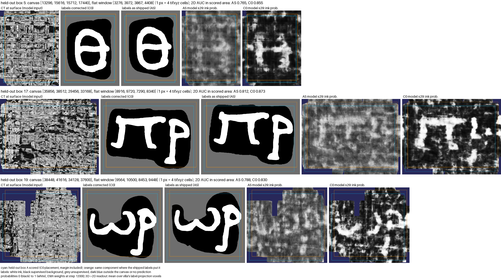

# Result A: labels as shipped against corrected labels on Paris4 w01

Written on 2026-11-07, after the last run of A finished at 08:18 +0800. The outcome follows the decision rule in `PREREG.md` section 7, which was frozen at commit e8b832b before the first training run. Everything that changed after the freeze is in `DEVIATIONS.md`.

## Outcome: cost measured

Training villa's `full_3d` ink trainer on w01 with the labels as shipped (AS) gave a lower held-out ink AUC than training on the same labels corrected for the HF65 offset (C0):

d = mean(C0) - mean(AS) = 0.0937 AUC, 95% interval 0.0641 to 0.1233 (pooled seed noise s = 0.0171, 6 degrees of freedom, t = 2.447, four seeds per arm).

The lower end of the interval is above zero, so section 7 gives "cost measured".

| run | primary: AUC on C0 labels | secondary: AUC on labels as shipped |
|---|---|---|
| C0 s27 | 0.8380 | 0.6341 |
| C0 s28 | 0.8393 | 0.6321 |
| C0 s29 | 0.8414 | 0.6445 |
| C0 s30 | 0.8294 | 0.6172 |
| AS s27 | 0.7130 | 0.5848 |
| AS s28 | 0.7456 | 0.6001 |
| AS s29 | 0.7707 | 0.6253 |
| AS s30 | 0.7440 | 0.5864 |

Primary means: C0 0.8370, AS 0.7434. Every C0 run scored above every AS run. With the same seed, C0 was ahead by 0.0707 to 0.1249. The difference is 28% of C0's headroom above chance (0.3370).

Each score comes from the EMA weights at step 12000. The primary reading covers 333 distinct held-out patches plus one repeat that stands in for patch 63, which has no admissible crop; the secondary reading covers all 343. (Corrected on 2026-11-12; the first version said all 334. See `ADDENDUM.md`.) `scripts/decide_w01.py` wrote the table and the outcome line to `results/results.md`. A separate recomputation from the `eval.json` and `eval_AS.json` files gives the same numbers to four decimals.

The secondary reading is listed without a verdict (section 6). Scored against the labels as shipped inside the held-out boxes, C0 still came out ahead: 0.6320 against 0.5991, d = 0.0329, interval 0.0061 to 0.0596.

The seed noise sits close to October's four-seed figure on w00 (s = 0.0168, `../labelshift/README.md`, Amendment J). Most of it comes from AS: the standard deviation over its four seeds is 0.0236, against 0.0053 for C0.

## Context from October

On w00, where the shipped offset is -1.6 to +17.4 px in y and -10.0 to +14.5 px in x, the labels as shipped gave no measurable cost (Amendment F, two seeds). A synthetic 128 px move of the corrected w00 labels cost 0.0513 AUC (C32y, Amendment J, four seeds). On w01 the shipped offset runs from +49.3 to +257.3 px in y and from -158.0 to -42.0 px in x, up to 288 px in length (`logs/check_arms_w01.log`). These comparisons are context and are not part of the decision rule.

## Figure

Added on 2026-11-09. [`figure/beforeafter_s29.png`](figure/beforeafter_s29.png) shows the three held-out boxes with the seed 29 checkpoints of both arms. The C0 model draws strokes that follow the letters in all three boxes. In the same places the AS model's map is faint and blurred. How the figure was made and what it checks is in [`figure/README.md`](figure/README.md).

## Seeds 31 and 32

Added on 2026-11-12. After this result was published, both arms were trained again with seeds 31 and 32. All six C0 runs scored above all six AS runs, and over six seeds d = 0.0847, 95% interval 0.0644 to 0.1051. These runs were not pre-registered, so the outcome above still rests on seeds 27 to 30. [`ADDENDUM.md`](ADDENDUM.md) has the details and the patch 63 correction.

## Limits

From `PREREG.md` section 9: one segment, trained on its own; three held-out components of that segment, which are a small sample of w01's ink, so the AUC difference speaks for those three areas; training at volume_scale 2 for 12000 steps (section 4), not at level 0 or with the teacher's 60k-step schedule; and a correction checked in nine w01 regions, six used by its fit and three not.

## Runs

Trainer code: villa at 37d1897fb (2026-10-29), as in October. Eight runs on one RTX 3070 Ti between 2026-11-04 19:16 and 2026-11-07 08:18 +0800. Each took 20,404 to 24,188 s including both evaluations, 48 hours in all. The first AS seed 27 attempt stopped on a network error and was rerun from step 0. On 2026-11-06 the machine restarted while the launcher was waiting between runs, with no run in progress. Both events are in `DEVIATIONS.md`.

## Files

- `results/results.md`: output of `scripts/decide_w01.py`.
- `results/runs/<arm>_s<seed>/`: `config.json`; `eval.json` (primary); `eval_AS.json` (secondary); `out/validation_metrics.jsonl`, the trainer's own validation log.
- `results/failed/AS_s27_20261105-025123/out/validation_metrics.jsonl`: the attempt that stopped on the network error.
- `results/desk_launch.log` and `results/run.log`: the launcher's logs.
- `figure/`: the before/after figure for seed 29 with its scripts and provenance, added on 2026-11-09.
- `ADDENDUM.md`, `results/extra/`, `results/addendum.md` and `extra_seeds.sh`: seeds 31 and 32, added on 2026-11-12.

Home directories in paths are written as `~`. Checkpoints are not in the repository.
